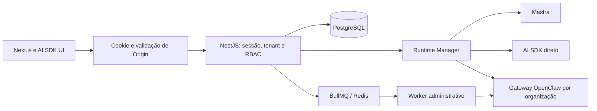

# Arquitetura

Monorepo npm workspaces mantido. Next.js 16 App Router → BFF same-origin → NestJS 12 → PostgreSQL/Prisma. Node 22.22+. O BFF mantém a credencial fora do JavaScript do navegador e encaminha SSE como stream.

API modular: identidade/equipe em `modules/identity/application`, builder em `modules/agent-builder`, agentes/runtime em `modules/agents`, canais/aprovações em `modules/collaboration`, consumo em `modules/billing`, organizações/dashboard em `modules/workspace`. Controllers preservam os contratos públicos e delegam regras aos serviços. Db fica em `platform/persistence/db.ts`; o export legado de `resources.ts` foi preservado. Onboarding, templates, tarefas e notificações mantêm controllers pequenos em `product.ts`. Bee Teams preexistente foi preservado e bloqueia novos repasses a agentes arquivados.

TanStack Query administra cache e invalidação nos fluxos P0. Troca de organização recarrega o documento, eliminando o cache anterior. RHF/Zod validam cadastro. Tailwind, shadcn/Radix, Lucide e Motion compõem a UI sobre a identidade existente. Builder separa componentes de etapa e tipos na feature `agent-builder`.

Pino registra HTTP sem credenciais/corpos/query strings. ValidationPipe aplica whitelist, forbidNonWhitelisted e transformação; JwtGuard verifica sessão e membership persistidos a cada operação. FKs compostas reforçam isolamento de referências no PostgreSQL.

Publicação permanece bloqueada: configuração versionada não significa implantação. `runtime-core`/`openclaw-adapter` foram preservados para a integração futura. Ingestão/RAG, ferramentas e execução OpenClaw não foram simulados. Limites e aprovação humana são configuração desejada, sem alegar enforcement de um runtime inexistente.

## Multimotor

O contrato de eventos está no pacote runtime-core. Adapters não conhecem controllers ou cookies. A API controla persistência, limites e stream de UI. O worker cria e verifica gateways; a API nunca executa Docker. A integração Teams preexistente foi preservada, sem ampliar billing ou colaboração multiagente nesta entrega.
